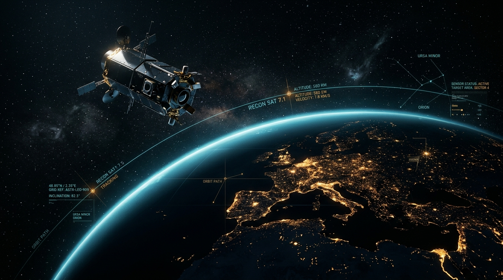

# 🛰️ Aerospace Cybersecurity Workshop Portal

An interactive, dark-themed tactical web portal designed for hands-on aerospace cybersecurity research, interactive simulation, and training. Features real-time RF radar simulations, avionics serial bus dissection, satellite orbit pass ground-station exploitation, live space surveillance radar tracking, and dynamic aerospace HUD visuals with live canvas wallpapers.



---

## 🌟 Key Features

### 1. 📡 Tactical Aerospace Simulators Workbench
* **Track 1: ADS-B 1090 MHz Radar & Spoofing Sandbox**
  * Real-time Mode S PPM packet stream monitor (1 Mbps).
  * Interactive radar PPI display with range rings, azimuth sweep, and aircraft telemetry.
  * Ghost aircraft injection simulation to demonstrate RF spoofing vulnerabilities without cryptographic authentication.
  * Multilateration (MLAT) defense demonstration to detect time-difference-of-arrival (TDOA) spoofing anomalies.
* **Track 2: Low Earth Orbit (LEO) & RF Waterfall Spectrogram**
  * Real-time orbital propagation simulation of CubeSat-01 (540 km altitude, 97.4° inclination).
  * 2D Ground track projection and live Doppler-shifted downlink waterfall spectrogram.
* **Track 3: Ground Station Exposed REST API Exploit**
  * Ground station antenna rotator control interface (`POST /api/v1/antenna/override`).
  * Simulates breaking RF lock by injecting malicious azimuth/elevation rotator commands.
* **Track 4: Avionics Serial Bus Inspector (ARINC 429 & MIL-STD-1553)**
  * Real-time flight instruments: Pressure Altitude (Label 203), Pitch Angle (Label 027), and True Airspeed (Label 210).
  * Interactive 32-bit ARINC 429 word crafting and bit-level dissection (Parity bit, SSM, Data Field, SDI, Label).
  * Malicious word injection with forced parity errors to trigger Line Replaceable Unit (LRU) fail-safes.
* **Live Meteor & Spacecraft Radar (CAMRAS Dwingeloo WebSDR / GRAVES 143.050 MHz)**
  * Faithful recreation of the CAMRAS 25-meter Radio Telescope WebSDR receiver at Dwingeloo Observatory, Netherlands.
  * High-resolution 512-bin FFT RF waterfall spectrogram with real-time Doppler scatter.
  * Real-time tracking of French GRAVES military space surveillance radar (143.050 MHz CW) reflections and Belgian BRAMS meteor beacon (49.98850 MHz USB).
  * Autonomous and manual detection of overdense/underdense meteor ionization trails and spacecraft Doppler S-curves (ISS, Tiangong, Hubble, Starlink).
  * Interactive click-to-tune waterfall canvas, S-meter bar with S-unit scale (`S1` to `+30 dB`), filter bandwidth tuning, and dual Waterfall / Spectrum oscilloscope views.
  * Acoustic Doppler audio synthesis for ionization pings and satellite whistle chirps.

### 2. 🌌 Aerospace HUD & Live Animated Wallpaper
* 95% translucent tactical frosted-glass UI (`backdrop-filter: blur(14px)`).
* Canvas-rendered live dynamic starfield, LEO orbital trajectory nodes, constellation telemetry vectors, and scanning HUD sweep.
* High-resolution dark aerospace orbital imagery.

### 3. 🎯 Curriculum & Module Master Timer
* Complete 4-module 45-minute workshop curriculum with interactive slide deck.
* Master workshop run-of-show countdown clock with automated module transitions and chime notifications.
* Interactive slide deck with speaker notes drawer, keyboard shortcuts (`←`/`→`, `S`, `F`), and module launch pills.

### 4. 🚩 CTF Tooling & Space Attack Surface Matrix
* Quick-reference cheatsheets for software-defined radios (HackRF, RTL-SDR, USRP), GNU Radio, `dump1090`, and Scapy.
* Aerospace vulnerability matrix mapping critical avionics and space ground-link attack vectors.

---

## 🚀 Quick Start (Local Deployment)

Clone the repository and run the built-in HTTP server:

```bash
# Clone the repository
git clone https://github.com/Allegorix/aerospace-cyber-workshop.git
cd aerospace-cyber-workshop

# Start the local server
python3 server.py
```

Open your browser and navigate to:
```
http://localhost:8080
```

---

## 🛠️ Project Structure

```
├── assets/
│   └── aerospace-bg.jpg            # Aerospace orbital imagery
├── css/
│   └── styles.css                  # UI styling with 95% transparency & radar HUD themes
├── js/
│   ├── simulators/
│   │   ├── adsb-radar.js           # ADS-B 1090 MHz radar & ghost injection simulator
│   │   ├── avionics-bus.js         # ARINC 429 & MIL-STD-1553 avionics bus inspector
│   │   ├── orbit-ground.js         # LEO orbit trajectory & SDR waterfall
│   │   ├── ctf-tooling.js          # CTF aerospace tooling cheatsheets
│   │   └── meteor-radar.js         # CAMRAS WebSDR GRAVES & BRAMS meteor radar
│   ├── app.js                      # Application controller & state management
│   ├── audio.js                    # Web Audio API acoustic Doppler & alert synthesizer
│   ├── data.js                     # Workshop slides, modules, and mission briefing data
│   └── live-wallpaper.js           # Interactive HUD constellation & starfield live wallpaper
├── index.html                      # Single-page application markup & workbench layout
├── server.py                       # Local HTTP server with CORS & MIME type handling
└── README.md                       # Project documentation
```

---

## 🛡️ License & Ethics
This project is built strictly for aerospace cybersecurity education, space domain awareness research, and ethical testing. Always adhere to Rules of Engagement (RoE) and FAA/ITU regulations regarding radio frequency emissions.
